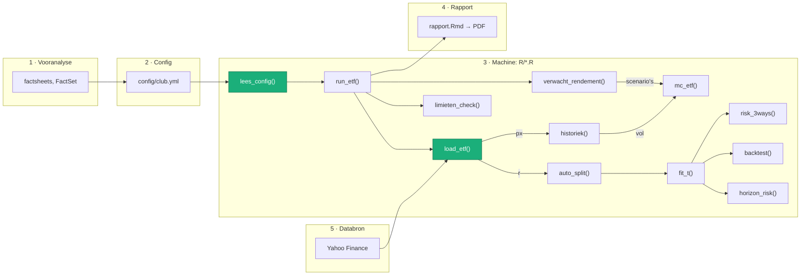

# Wat wanneer gedaan

| Dag | Datum      | Gedaan                              |
|:----|:-----------|:------------------------------------|
| 1   | 10/10/2026 | repo, renv, config, `lees_config()` |
| 2   | 11/10/2026 | `club.yml`, `load_etf()`, mermaid diagram  |

# Functies

| Functie            | Bestand    | Doet                                               | Geeft terug                 |
|:-------------------|:-----------|:---------------------------------------------------|:----------------------------|
| `lees_config(pad)` | `R/data.R` | leest een config, vult elke ETF aan met `algemeen` | lijst met één `cfg` per ETF |
| `load_etf(ticker, from)` | `R/data.R` | haalt koersen, zet om naar euro, doet datachecks   | lijst met `px`, `r`, `koers`, `checks`, … |

# Configuratie

Config = invoer, `R/*.R` = machine. Andere ETF of aanname? Alleen de config aanpassen.

`config/*.yml` → `lees_config()` → één `cfg` per ETF → `R/*.R` → resultaten per ETF

| Bestand    | Doel                                | Aanpassen? |
|:-----------|:------------------------------------|:-----------|
| `etfs.yml` | gewoon een testdatabank vo mezelf   | nooit      |
| `club.yml` | analyse voor de club                | ja         |

| Soort      | Velden                                                            | Aanpassen wanneer                |
|:-----------|:------------------------------------------------------------------|:---------------------------------|
| club       | `positie`, `portefeuille`, `cash`                                 | aankoop, verkoop, nieuw kapitaal |
| model      | `horizon`, `min_test`, `min_train`, `frac_test`, `centrum`        | zelden                           |
| ETF-feiten | `ticker`, `naam`, `type`, `sector`, `ter`, `top_positie`, `start` | nieuwe ETF of factsheet          |
| aannames   | `pe0`, `dy`, `ytm`, `duration`, scenario's                        | vóór elke pitch                  |

# Diagram (via mermaid)

