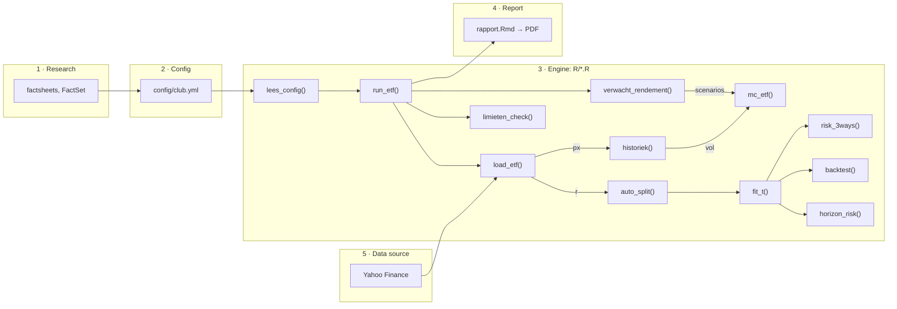

https://github.com/user-attachments/assets/715bba99-5dc2-4c91-b8e5-4cee5fa53e5c

# ETF engine

Feed it an ETF. Get back a full risk report as a PDF.
Built in R for [Le Gradient](https://legradient.be), the student investment club in Ghent.

## Why we made this

At Le Gradient we pitch ETFs / stocks and vote on them together.
A good pitch takes a lot of work: data, forecasts, risk numbers.
Doing all of that by hand for every ETF takes ages.

So we built an engine that does the heavy lifting.
For every ETF it answers three questions:

1. What did it do in the past?
2. What can we expect?
3. How much can we lose?

Same method for every ETF. Same report every time.
That makes it easy to compare ETFs side by side.
And we get to spend our time on the fun part: the discussion before the vote.

## Quick start

You need [R](https://cran.r-project.org) (version 4.4 or newer) and [RStudio](https://posit.co/download/rstudio-desktop/). That's it.

Never used R? YouTube "install R and RStudio" and you're good.
(R is goated for this kind of project.)
Total newbie? [SETUP.md](SETUP.md) walks you through every click, for Mac and Windows.

1. **Get the code.** In a terminal:
   ```bash
   git clone https://github.com/batistedecat/etf-model-1.git
   ```
2. **Open the project.** Double-click `etf-model-1.Rproj`. RStudio opens.
3. **Install the packages.** In the R Console:
   ```r
   renv::restore()
   ```
   It asks if you want to proceed. Type `Y` and press Enter.
   This installs the exact versions we use. The first time takes a few minutes. Grab a coffee.
4. **Install LaTeX.** You need it for the PDFs. Only once:
   ```r
   tinytex::install_tinytex()
   ```
   Then restart RStudio. Already have LaTeX? Skip this.
5. **Hit run.**
   ```r
   source("run_all.R")
   ```
   The first run downloads all the prices, so give it a minute.
6. **Check the results** in the `out/` folder:
   - one PDF per ETF, like `QDVE_DE.pdf`
   - `vergelijking.csv`, with all ETFs side by side

Done. You just ran a risk model.

## Add your own ETF

All the input lives in one file: `config/club.yml`.
You never have to touch the R code.

1. Copy an ETF block in `config/club.yml` and paste it under the others.
2. Fill in the fields (see the table).
3. Run `source("run_all.R")` again.

The field names are Dutch. Sorry haha.

The top part (`algemeen`) holds the settings for every ETF:
how much we invest (`positie`), the size of the portfolio (`portefeuille`),
our cash (`cash`) and how many years we look ahead (`horizon`).

| Field | What it is | Where to find it |
|:--|:--|:--|
| `ticker` | the code on Yahoo Finance | search the fund on finance.yahoo.com, e.g. `QDVE.DE` |
| `naam` | the name | whatever you like |
| `type` | `aandelen` (stocks), `obligaties` (bonds) or `overig` (anything else, like gold) | the factsheet |
| `sector` | e.g. `technologie`, or `gespreid` for a broad fund | the factsheet |
| `ter` | yearly cost: `0.0015` means 0.15% | the factsheet |
| `top_positie` | weight of the biggest company in the fund | the holdings tab on the fund's website |
| `pe0` | the P/E today | FactSet Earnings Insight or the factsheet |
| `dy` | dividend yield (or rate change if of type `obligaties`(bonds) | the factsheet |
| `g` | yearly profit growth, per scenario | analyst forecasts plus your own judgement |
| `peH` | the P/E at the end of the horizon, per scenario | your call: will the market pay more or less? |
| `ytm`, `duration` | yield and duration (bond funds only) | the factsheet |

**Where's the factsheet?** On the website of the company behind the fund: iShares, Vanguard, Xtrackers, Amundi…
Search the fund name or its ISIN there and open the fund page.
You'll find the factsheet (a short PDF) under "Documents", and the full list of holdings in its own tab.
In a hurry? [justETF](https://www.justetf.com) shows the cost, size and top holdings of most ETFs on one page.

Every ETF gets three scenarios: bear (things go badly), base (your best guess) and bull (things go well).

**Heads up:** changing `horizon`? Then change `peH` too. It's the P/E at the *end* of the horizon, so it depends on it.

## Next pitch? The routine

Back for a new ETF a few months later? Do this:

1. **Grab the latest version.** In a terminal:
   ```bash
   git restore .
   git pull
   ```
   Heads up: `git restore .` wipes your own changes from last time. Want to keep your old config? Copy it somewhere first.
2. **Open the project** and run `renv::restore()`. Nothing changed? It's done in a sec.
3. **Update the club numbers** in `config/club.yml`: `positie`, `portefeuille` and `cash`. The club grows, these change.
4. **Add the new ETF** as a block (see above). Old ETFs you don't need anymore? Delete their block.
5. **Refresh the old numbers too.** `pe0`, `dy`, `g` and `peH` go stale fast. Check them again.
6. **Restart R** (Session → Restart R) and run `source("run_all.R")`.
7. **Read the PDFs.** An assumption looks off? Tweak it and run again.
8. **Share the PDFs** from `out/` with the board before the vote.

That's it. Pitch ready.

## What the engine does (and why)

This is what happens when you hit run.
Every step lives in its own file in `R/`.

1. **Get the data** (`data.R`)
   Downloads daily prices from Yahoo Finance and converts them to euro.
   *Why:* garbage in, garbage out. So it also checks for gaps, weird jumps and wrong prices.

2. **Look back** (`historiek.R`)
   Average return, volatility and every big drop (drawdown).
   *Why:* before you buy, you want to know how wild the ride was.

3. **Forecast the return** (`rendement.R`)
   Profit growth + change in P/E + dividend − costs. That's the Grinold–Kroner model. Bonds get their own formula.
   It also works out the break-even: how much growth do we need to make 8% a year?
   *Why:* the past is no promise. We want a forecast built on reasons, not on vibes.

4. **Simulate the future** (`montecarlo.R`)
   10,000 random paths of our money over the horizon. That's a Monte Carlo simulation.
   *Why:* one number hides the risk. 10,000 paths show the good, the bad and the ugly.

5. **Measure daily risk** (`risico.R`)
   Value-at-Risk and Expected Shortfall: how much can we lose on a bad day? Three methods, one of them a Student-t.
   *Why:* markets crash way more often than the bell curve says. The Student-t takes that seriously.

6. **Test the risk model** (`risico.R`)
   We train on old data and check on recent data the model has never seen. That's a backtest.
   *Why:* a model that only works on paper is useless. This catches it.

7. **Risk over the horizon** (`risico.R`)
   The average loss in the worst 5% of cases, over 1 year and over our horizon.
   *Why:* the club doesn't sell after one day. We care about the whole period.

8. **Check the club rules** (`pipeline.R`)
   Max 30% per ETF, 40% per sector, 20% per company, and at least 5% cash.
   *Why:* those are our rules. The engine warns us before we break them.

9. **Write the report** (`rapport.Rmd`)
   Everything above in one PDF, in plain English, with charts.
   *Why:* so everyone can read it before the vote. 

`run_etf()` in `pipeline.R` runs steps 1 to 8 for one ETF.
`run_all.R` does it for every ETF in the config and writes the reports.



`px` = prices, `r` = daily log-returns, `vol` = volatility.

## Check that everything works

```r
testthat::test_dir("tests/testthat")
```

You want to see `FAIL 0`.
Error about `testthat`? Run `renv::install("testthat")` first.

## Disclaimer

This is not investment advice.
The engine is only as good as the numbers you put in `club.yml`.
It helps us think. It doesn't think for us.

## Project map

| Path | What's in it |
|:--|:--|
| `config/` | the input: `club.yml` (the club) and `etfs.yml` (test ETFs) |
| `R/` | the engine |
| `rapport.Rmd` | the report template |
| `run_all.R` | the start button |
| `tests/` | checks that the math still works |
| `SETUP.md` | step-by-step install guide for newbies |


Made by Batiste Decat for [Le Gradient](https://legradient.be). Questions? ask me via mail: batiste.decat@ugent.be
